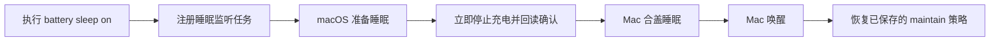
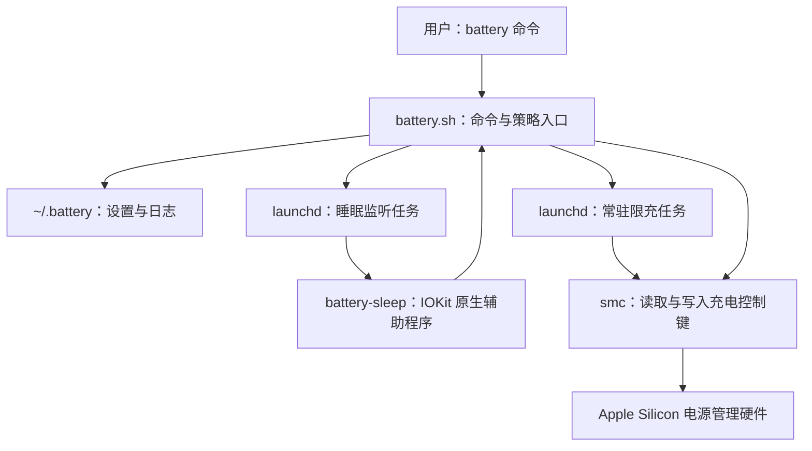
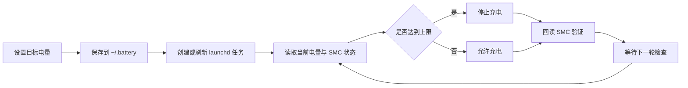

# Battery：Apple Silicon MacBook 充电控制增强版

> 专注于稳定限充、重启恢复和合盖睡眠保护的 macOS 命令行工具。

[English backup](README.en.md) · [上游项目](https://github.com/actuallymentor/battery) · [本仓库](https://github.com/tianwuziyan/battery)

> [!IMPORTANT]
> 本仓库是在 [actuallymentor/battery](https://github.com/actuallymentor/battery) 基础上继续完善和修改的维护增强分支，并非上游官方版本。当前改进重点是解决新版 macOS 与 Apple Silicon 设备上出现的限充失效、重启后维护任务未恢复、重复后台进程、SMC 写入假成功，以及合盖睡眠期间继续充到 100% 等问题。

## 项目简介

长期连接电源时，把电池维持在较低电量通常比长期保持 100% 更有利于电池寿命。macOS 自带的“优化电池充电”会根据使用习惯自动判断，但不能保证始终停在用户指定的百分比。

Battery 允许你直接执行 `battery maintain 75`，让 MacBook 在达到 75% 后停止充电，并在电量下降后恢复充电。本增强分支保留上游的核心命令行能力，同时强化新版 macOS 的 SMC 兼容、launchd 后台任务管理和合盖睡眠保护。项目目前以“可靠控制充电”为主要目标，不追求额外的电池分析或复杂界面功能。

## 本分支的主要改进

| 改进 | 解决的问题 | 当前行为 |
|---|---|---|
| 新版 SMC 能力检测 | 新系统继续写入旧 SMC 键，命令看似成功但实际未生效 | 自动识别可用充电控制键，并在写入后回读确认 |
| 重启后自动恢复 | 重新登录后限充进程消失 | 通过用户级 launchd 任务恢复已保存的维护策略 |
| 单实例后台维护 | 多次执行命令后出现重复维护进程 | 注册前清理旧进程并确认 launchd 运行状态 |
| 合盖睡眠保护 | 合盖后系统睡眠，电池仍可能继续充到 100% | 入睡前暂停充电，唤醒后恢复原来的 `maintain` 策略 |
| 安装与更新固定到本 fork | 更新后又被上游旧脚本覆盖 | `setup.sh`、`update.sh` 和 CLI 更新均从本仓库获取 |
| 安全安装与兼容路径 | 权限、旧路径和 GUI 兼容问题 | 核心文件由 root 持有，并保留 `/usr/local/bin` 兼容链接 |

## 适用环境

- Apple Silicon Mac（M1、M2、M3、M4 等）
- macOS；不支持 Intel Mac
- 使用合盖保护时，需要安装仓库自带的 `dist/battery-sleep` 原生辅助程序
- 安装时需要管理员密码；日常执行限充命令不需要反复输入密码

> 原生合盖辅助程序当前以 macOS 13 为最低部署目标。Apple 的 SMC 接口并非公开稳定 API，系统升级后仍可能需要继续适配。

## 安装

### 方式一：让 AI 编码工具协助安装

可以在 VS Code 中把下面这段话交给 Codex 或其他能操作终端的编码助手：

```text
请从 https://github.com/tianwuziyan/battery 安装 Battery CLI。
先检查仓库中的 README.md 和 setup.sh，再执行官方安装脚本；
安装后验证 battery --version、battery status 和 battery sleep status，
不要删除我其他项目或修改无关的系统配置。
```

安装过程需要输入 macOS 管理员密码时，仍需由你本人完成。

### 方式二：一行命令安装（推荐）

```bash
curl -sSL https://raw.githubusercontent.com/tianwuziyan/battery/main/setup.sh | bash
```

安装脚本会：

1. 从本仓库 `main` 分支下载最新版；
2. 将 `battery`、`smc` 和 `battery-sleep` 安装到 `/usr/local/co.palokaj.battery`；
3. 创建 `/usr/local/bin/battery` 与 `/usr/local/bin/smc` 兼容链接；
4. 写入受限的 sudoers 规则；
5. 恢复已经保存的限充和合盖保护设置。

### 方式三：克隆后安装

```bash
git clone https://github.com/tianwuziyan/battery.git
cd battery
bash setup.sh
```

安装完成后，新开一个终端并验证：

```bash
battery --version
battery status
battery sleep status
```

## 快速开始

只需要限制充电并防止合盖后充满，可以执行：

```bash
# 把电量维持在 75%
battery maintain 75

# 开启合盖睡眠保护（只需开启一次）
battery sleep on

# 查看当前状态
battery status
battery sleep status
```

设置会保存在 `~/.battery`，重新登录或重启后由 launchd 自动恢复。

## 常用命令

| 命令 | 作用 |
|---|---|
| `battery maintain 75` | 把充电上限设为 75% |
| `battery maintain 70-80` | 在 70% 到 80% 之间维护电量 |
| `battery maintain stop` | 停止自动限充并恢复正常充电 |
| `battery sleep on` | 开启合盖睡眠保护 |
| `battery sleep off` | 关闭合盖睡眠保护 |
| `battery sleep status` | 查看合盖保护是否运行 |
| `battery status` | 查看电量、供电和 SMC 充电状态 |
| `battery logs 100` | 查看最近 100 行日志 |
| `battery charging off` | 手动停止充电，同时停止自动维护 |
| `battery charging on` | 手动恢复充电，同时停止自动维护 |
| `battery update` | 从本 fork 的 `main` 分支更新 |
| `battery reinstall` | 重新运行完整安装流程 |
| `battery uninstall` | 恢复充电并卸载 Battery |

运行 `battery` 或 `battery help` 可以查看完整命令说明。上游保留的电压维护、校准、单次充电和主动放电等高级命令仍然存在，但不是本分支当前的维护重点。

## 合盖睡眠保护是怎样工作的

`battery maintain 75` 负责电脑正常运行时的限充；`battery sleep on` 是额外的睡眠保险。两个命令属于同一个 `battery` 工具，不需要单独安装第二个程序。



- 开启后，原生辅助程序只监听系统睡眠与唤醒事件。
- 收到即将睡眠事件时，Battery 会先停止充电；确认失败则记录错误，不会假装已经生效。
- 唤醒后重新读取原来的百分比设置：低于目标时允许充电，达到目标时继续停止充电。
- 该功能默认关闭，使用 `battery sleep on` 开启一次即可持久保留。

> [!NOTE]
> 睡眠保护的设计目标是“合盖期间不要继续充电”。因此即使合盖时电量低于 75%，开启该功能后，睡眠期间也会暂停充电，唤醒后才恢复原策略。目前它只配合百分比 `maintain` 策略，不处理电压维护模式。

## 系统架构



| 模块 | 职责 |
|---|---|
| `battery.sh` | CLI 入口、限充策略、SMC 能力检测、写入回读与 launchd 管理 |
| `dist/smc` | 读取和写入 Apple Silicon 的 SMC 键 |
| `src/battery-sleep.c` | 使用 IOKit 监听睡眠/唤醒事件 |
| `dist/battery-sleep` | 安装时使用的预编译合盖辅助程序 |
| launchd 任务 | 在登录、重启和唤醒后维持后台策略 |
| `~/.battery` | 保存目标电量、开关状态和运行日志 |

## 工作流程



核心原则是“写入后必须验证”。仅仅看到 `smc -w` 返回成功并不能证明硬件状态已经改变，因此新版流程会读取实际键值，并在不一致时返回失败。

## 技术栈

| 层级 | 技术 | 用途 | 选择原因 |
|---|---|---|---|
| 命令行核心 | Bash | 命令解析、限充策略、安装与更新 | 与 macOS 系统工具配合直接，便于审计 |
| 原生睡眠监听 | C、IOKit、CoreFoundation | 接收系统睡眠和唤醒通知 | 比轮询更及时，能在入睡前执行控制 |
| 后台运行 | launchd | 重启恢复、单实例维护和睡眠监听 | macOS 原生任务管理机制 |
| 硬件控制 | 预编译 `smc` 工具 | 读写充电、放电和 MagSafe LED 键 | 延续上游已有的底层实现 |
| 图形界面 | Electron（上游保留） | 菜单栏界面 | 兼容原项目；本 fork 当前主要维护 CLI |
| 验证 | Shell 测试、`plutil`、`clang` | 回归测试 plist、脚本和原生辅助程序 | 覆盖稳定性改动的关键路径 |

## 项目结构

```text
battery/
├── battery.sh              # 主命令行程序
├── setup.sh                # 完整安装脚本
├── update.sh               # 增量更新脚本
├── src/
│   └── battery-sleep.c     # 睡眠/唤醒监听源码
├── dist/
│   ├── smc                 # 预编译 SMC 工具
│   └── battery-sleep       # 预编译睡眠监听程序
├── tests/                  # 进程、launchd、SMC 和安装测试
├── app/                    # 上游 Electron 菜单栏应用
├── screenshots/            # 文档截图
├── README.md               # 中文主文档
└── README.en.md            # 修改前的英文文档备份
```

## 如何确认限充真的生效

在新版 macOS 上，不要只看菜单栏的闪电图标。建议同时检查：

```bash
battery status
pmset -g batt
```

正常达到上限时，`battery status` 应显示 SMC charging disabled，`pmset -g batt` 应显示类似：

```text
75%; AC attached; not charging
```

在部分运行 macOS Tahoe 26.4 或更高版本的设备上，菜单栏仍可能显示闪电或“充电到 100%”，即使系统和 SMC 已经报告停止充电。这是系统界面状态与底层控制不同步，不能单凭图标判断失败。

## 重启与合盖后的检查

```bash
# 限充后台进程
pgrep -fl '/usr/local/co.palokaj.battery/battery maintain_'

# 限充任务状态
launchctl print "gui/$(id -u)/com.battery.app" | \
  grep -E 'state =|pid =|runs =|last exit code'

# 合盖保护任务状态
launchctl print "gui/$(id -u)/com.battery.sleep" | \
  grep -E 'state =|pid =|runs =|last exit code'

# 最近的睡眠保护日志
grep -E 'Pausing charging|Restoring battery' \
  "$HOME/.battery/battery.log" | tail -n 10
```

正常情况下，每种任务只应有一个运行中的进程。

## 更新与卸载

更新到本 fork 的最新版本：

```bash
battery update
```

如果安装结构损坏或缺少 `battery-sleep`：

```bash
battery reinstall
```

卸载前，Battery 会先停止后台任务并恢复充电：

```bash
battery uninstall
```

卸载会删除 `/usr/local/co.palokaj.battery`、兼容链接、sudoers 规则以及 `~/.battery` 配置和日志。

## 开发与验证

修改代码后，可运行仓库内的回归测试：

```bash
bash tests/process-management.sh
bash tests/launchd-management.sh
bash tests/smc-write-readback.sh
bash tests/fork-installation.sh
bash tests/sleep-protection.sh
```

检查原生辅助程序源码和二进制：

```bash
clang -fsyntax-only -Wall -Wextra -Werror src/battery-sleep.c
codesign --verify --verbose=2 dist/battery-sleep
```

涉及 `battery.sh`、SMC 命令或 sudoers 权限时，请先阅读 [AGENTS.md](AGENTS.md) 中的仓库约束。

## 已知限制

- Apple 没有公开保证这些 SMC 键长期稳定，重大系统升级后可能需要重新适配。
- Tahoe 26.4+ 的菜单栏图标可能仍显示正在充电，应以 `battery status` 和 `pmset -g batt` 为准。
- MagSafe 指示灯是否响应由具体机型、线缆和固件共同决定；灯光颜色不是判断限充是否生效的可靠依据。
- 合盖保护会在整个睡眠期间暂停充电；需要合盖时补电的用户应使用 `battery sleep off`。
- 原生睡眠辅助程序目前只提供 arm64 预编译版本，不支持 Intel Mac。

## FAQ

### 为什么已经有 `battery maintain 75`，还需要 `battery sleep on`？

正常运行时，`maintain` 后台循环会定期检查电量；进入睡眠后，这个 Bash 循环不会继续运行。睡眠保护会在 macOS 真正睡下前主动停止充电，唤醒后再恢复 `maintain`，用于避免合盖期间充满。

### `battery` 和 `battery-sleep` 是两个需要分别使用的工具吗？

不是。用户只需要操作 `battery` 命令。`battery-sleep` 是内部原生辅助程序，由 `battery sleep on` 自动注册和管理，不需要手动运行。

### 设置会不会在重启后失效？

目标电量保存在 `~/.battery/maintain.percentage`，用户登录后 launchd 会恢复维护进程。合盖保护的开关也会保存，并在重新安装、更新或登录后恢复。

### 为什么到达 75% 后图标仍写着“充电到 100%”？

新版 macOS 的菜单栏显示可能没有同步 SMC 的实际充电状态。运行 `pmset -g batt`；如果显示 `AC attached; not charging`，说明已经停止充电。

### 如何关闭所有限制并恢复正常充电？

```bash
battery sleep off
battery maintain stop
```

## 贡献

欢迎提交 Issue 或 Pull Request。修改前请先阅读 [AGENTS.md](AGENTS.md)，并确保相关测试通过。若改动 `battery.sh`，必须同步递增其中的 CLI 版本号。

## License 与致谢

本项目基于 [actuallymentor/battery](https://github.com/actuallymentor/battery) 修改，并继续采用 [MIT License](LICENSE)。原项目版权归 Mentor Palokaj 及相应贡献者所有。

底层预编译 `smc` 工具来源于 [hholtmann/smcFanControl](https://github.com/hholtmann/smcFanControl)。感谢上游项目、相关贡献者及测试用户。
