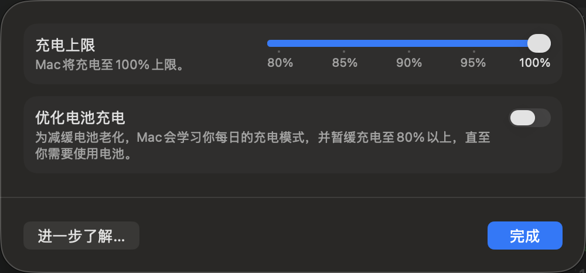
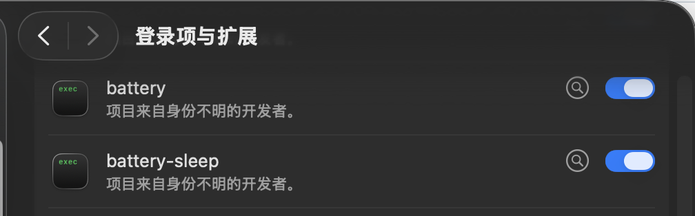
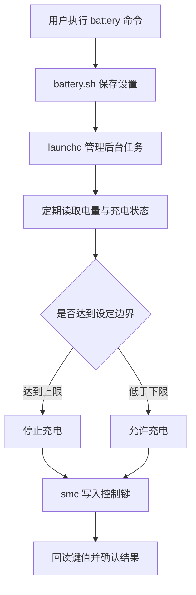
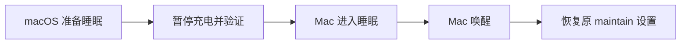

# Battery：Apple Silicon MacBook 充电控制增强版

> 为 MacBook 设置明确的充电上限，并在重启、重新登录和合盖睡眠后继续生效。

[English backup](README.en.md) · [上游项目](https://github.com/actuallymentor/battery) · [本仓库](https://github.com/tianwuziyan/battery)

> [!IMPORTANT]
> 本仓库基于 [actuallymentor/battery](https://github.com/actuallymentor/battery) 继续维护，并非上游官方版本。主要改进集中在新版 macOS 兼容、后台任务恢复、SMC 写入验证和合盖睡眠保护，不以增加额外功能为目标。

## 项目简介

macOS 自带的“优化电池充电”会根据使用习惯决定何时暂停充电，但不能保证始终停在指定百分比。Battery 提供了一套命令行控制方式，例如执行 `battery maintain 75` 后，电量达到 75% 时停止充电，低于 75% 时重新允许充电。

这个维护分支重点解决原版在新版 macOS 上遇到的几个实际问题：限充命令看似成功但没有生效、重启后维护任务消失、重复后台进程，以及 Mac 合盖睡眠后继续充到 100%。

## 本分支的改进

| 改进 | 作用 |
|---|---|
| 新版 SMC 能力检测 | 根据当前 Mac 支持的控制键选择正确写法，兼容新版 macOS |
| 写入后回读验证 | 不只检查命令返回值，还会确认底层充电状态确实改变 |
| launchd 后台恢复 | 重新登录或重启后，自动恢复保存的充电上限 |
| 单实例维护 | 新设置启动前先停止旧任务，避免多个维护进程同时运行 |
| 合盖睡眠保护 | 睡眠前暂停充电，唤醒后恢复原来的限充设置 |
| fork 独立更新 | 安装和更新均从本仓库获取，不会被上游旧脚本覆盖 |

## 适用环境

- Apple Silicon Mac（M1、M2、M3、M4 等）；
- 不支持 Intel Mac；
- 合盖保护程序当前要求 macOS 13 或更高版本；
- 安装时需要管理员密码，日常执行限充命令通常不需要再次输入。

Apple 没有公开保证这些 SMC 控制方式长期不变，因此 macOS 大版本更新后仍可能需要重新适配。

## 安装

在终端执行：

```bash
curl -sSL https://raw.githubusercontent.com/tianwuziyan/battery/main/setup.sh | bash
```

安装脚本会把 `battery`、`smc` 和合盖辅助程序安装到 `/usr/local/co.palokaj.battery`，同时创建命令行兼容链接并配置必要权限。

如果终端出现 `Password:`，请输入当前 Mac 用户的管理员密码并按回车。输入过程中不显示字符属于正常现象。

安装完成后，重新打开终端并检查：

```bash
battery --version
battery status
```

已经下载本仓库的用户，也可以在仓库目录执行：

```bash
bash setup.sh
```

## 快速开始

### 固定在一个百分比

```bash
battery maintain 75
```

- 电量低于 75%：允许充电；
- 电量达到 75%：停止充电；
- 设置会保存，重启后自动恢复。

### 维持在一个范围

```bash
battery maintain 70-80
```

- 电量达到 80%：停止充电；
- 电量低于 70%：重新允许充电；
- 电量处于 70%～80%：保持当前充电状态，减少频繁切换。

范围模式的下限不得低于 10%，上限不得超过 100%，且下限必须小于上限。

### 防止合盖后继续充电

```bash
battery sleep on
```

开启后，Mac 准备睡眠时会先暂停充电，唤醒后再恢复之前保存的 `maintain` 设置。此开关只需设置一次，重启后仍然保留。

日常长期插电可以使用：

```bash
battery maintain 70-80
battery sleep on
```

如果希望电量更接近固定值，则使用 `battery maintain 75`。

## macOS 系统设置参考

下面两张截图是 macOS 自带的系统设置，用来说明系统层面的充电上限和登录项。它们不是 Battery 的操作界面，Battery 的实际充电控制仍应以 `battery status` 和 `pmset -g batt` 的结果为准。

### 电池设置

此处可以看到 macOS 自带的“充电上限”和“优化电池充电”选项。它们与 `battery maintain` 属于两套独立机制；如果需要明确、固定的百分比上限，应以 Battery 命令设置为准，避免同时使用两套策略造成判断混淆。

<p align="center">
  
</p>

### 登录项与扩展

安装后，系统设置的“登录项与扩展”中会显示 `battery` 和 `battery-sleep`。这表示 macOS 允许相关程序在登录时加载，是重启后恢复后台任务的系统配合项。

<p align="center">
  
</p>

如果需要确认任务当前是否真的在运行，请继续使用后面的 `battery sleep status`、`battery status` 和 `launchctl print` 检查；登录项开关本身不能替代运行状态检查。

## 命令说明

### 限充与状态

| 命令 | 含义与实际效果 |
|---|---|
| `battery maintain 75` | 设置固定上限。达到 75% 停止充电，低于 75% 重新允许充电 |
| `battery maintain 70-80` | 设置维护范围。达到 80% 停止充电，低于 70% 重新允许充电 |
| `battery maintain 80 --force-discharge` | 如果当前电量高于 80%，先在插电状态下主动放电到 80%，再开始限充 |
| `battery maintain 70-80 --force-discharge` | 先主动放电到范围下限 70%，再执行 70%～80% 维护 |
| `battery maintain stop` | 停止自动限充任务，并恢复正常充电；不会卸载程序 |
| `battery status` | 显示当前电量、剩余时间、SMC 充电状态和正在执行的维护设置 |
| `battery logs 100` | 显示最近 100 行 CLI、GUI 日志和配置状态；数字可以自行调整 |

`--force-discharge` 会增加电池循环消耗，也不适合合盖模式。普通限充不需要添加这个选项。

### 合盖睡眠保护

| 命令 | 含义与实际效果 |
|---|---|
| `battery sleep on` | 开启睡眠保护；入睡前暂停充电，唤醒后恢复当前 `maintain` 设置 |
| `battery sleep off` | 关闭睡眠保护；不会删除或停止现有 `maintain` 设置 |
| `battery sleep status` | 显示睡眠保护当前是 `on` 还是 `off` |

睡眠保护的目标是避免合盖期间继续充电。因此即使合盖时电量低于上限，睡眠期间也会暂停充电，唤醒后才恢复原来的维护策略。目前睡眠保护只配合百分比模式，不处理电压维护模式。

### 手动控制充电与电源适配器

| 命令 | 含义与实际效果 |
|---|---|
| `battery charging off` | 先停止自动维护，再立即停止给电池充电 |
| `battery charging on` | 先停止自动维护，再立即允许电池充电 |
| `battery adapter off` | 停止自动维护，并让 Mac 在插电时仍使用电池，即强制放电 |
| `battery adapter on` | 取消强制放电，恢复使用外接电源供电 |

`charging on/off` 控制“是否给电池充电”；`adapter on/off` 控制“是否使用外接电源”。两者含义不同。手动控制会停止当前自动维护；如果还需要继续限充，请重新执行对应的 `battery maintain ...` 命令。

### 单次充电、放电与校准

| 命令 | 含义与实际效果 |
|---|---|
| `battery charge 90` | 临时充到 90%，到达后停止充电，再尝试恢复之前的 `maintain` 设置 |
| `battery discharge 60` | 插电状态下主动放电到 60%，完成后停止强制放电并恢复之前的设置 |
| `battery calibrate` | 依次放电到 15%、充到 100%、保持 1 小时、放电到 80%，最后恢复限充 |

主动放电和校准会产生额外的电池循环。校准过程耗时较长，不建议作为日常操作。

### 电压模式

```bash
battery maintain 11.4V
battery maintain 11.4V 0.3V
```

第一条命令默认在目标电压上下浮动 0.1V，即约 11.3V～11.5V。第二条命令把浮动范围改为 0.3V，即约 11.1V～11.7V。普通用户使用百分比模式即可。

### 更新、修复与卸载

| 命令 | 含义与实际效果 |
|---|---|
| `battery update` | 从本仓库 `main` 分支更新；版本变化后会重新启动原维护任务 |
| `battery reinstall` | 重新执行完整安装，用于修复文件缺失、权限或安装结构问题 |
| `battery uninstall` | 停止后台任务、恢复正常充电，然后删除程序、配置和日志 |
| `battery --version` | 显示当前安装版本 |
| `battery help` | 显示内置帮助；直接执行 `battery` 效果相同 |

## 设置会不会互相冲突？

不会。同一时间只会运行一套 `maintain` 设置。

例如先执行：

```bash
battery maintain 75
```

随后再执行：

```bash
battery maintain 70-80
```

程序会停止旧维护进程，把保存的设置改为 `70-80`，再启动新的后台任务。最终只有 `70-80` 生效。

`battery sleep on` 也不是第二套充电上限。它只负责睡眠前暂停充电、唤醒后恢复当前 `maintain` 设置。

## 如何确认限充已经生效？

在新版 macOS 上，不建议只根据菜单栏闪电图标判断。请同时执行：

```bash
battery status
pmset -g batt
```

达到上限后，`battery status` 应显示：

```text
smc charging disabled
```

`pmset -g batt` 应显示类似：

```text
75%; AC attached; not charging
```

部分运行 macOS Tahoe 26.4 或更高版本的 Mac，菜单栏仍可能显示闪电或“充电到 100%”，即使底层已经停止充电。MagSafe 指示灯也可能受机型、线缆和固件影响，因此应以 `battery status` 和 `pmset` 结果为准。

## 重启与合盖后的检查

先检查用户状态：

```bash
battery status
battery sleep status
```

需要进一步排查时，可以检查后台任务：

```bash
# 正常应只显示一个维护进程
pgrep -fl '/usr/local/co.palokaj.battery/battery maintain_'

# 限充任务
launchctl print "gui/$(id -u)/com.battery.app" | \
  grep -E 'state =|pid =|runs =|last exit code'

# 合盖保护任务
launchctl print "gui/$(id -u)/com.battery.sleep" | \
  grep -E 'state =|pid =|runs =|last exit code'

# 最近的睡眠与唤醒记录
grep -E 'Pausing charging|Restoring battery' \
  "$HOME/.battery/battery.log" | tail -n 10
```

## 工作原理



后台维护任务由 launchd 管理，因此可以在重新登录或重启后恢复。每次写入 SMC 后，程序会重新读取对应键值；只有读回结果一致，才认为控制已经生效。

合盖保护由内部的 `battery-sleep` 辅助程序监听系统事件：



用户不需要直接运行 `battery-sleep`，只需使用 `battery sleep on/off/status`。

## 技术组成与项目结构

| 组成 | 用途 |
|---|---|
| Bash / `battery.sh` | CLI、限充逻辑、SMC 检测、安装与更新 |
| launchd | 维护进程与睡眠监听任务的启动和恢复 |
| `dist/smc` | 读取和写入 Apple Silicon SMC 键 |
| C / IOKit / `battery-sleep` | 接收睡眠与唤醒通知 |
| `~/.battery` | 保存维护设置、睡眠开关和日志 |
| Shell 测试 | 验证进程管理、SMC 回读、安装和睡眠保护 |

```text
battery/
├── battery.sh              # 主命令行程序
├── setup.sh                # 完整安装脚本
├── update.sh               # 增量更新脚本
├── src/battery-sleep.c     # 睡眠/唤醒监听源码
├── dist/                   # 预编译 smc 与 battery-sleep
├── tests/                  # 自动化回归测试
├── app/                    # 上游 Electron 菜单栏应用
├── screenshots/            # README 使用的界面截图
├── README.md               # 中文文档
└── README.en.md            # 英文文档备份
```

## 开发与验证

```bash
bash tests/process-management.sh
bash tests/launchd-management.sh
bash tests/smc-write-readback.sh
bash tests/fork-installation.sh
bash tests/sleep-protection.sh

clang -fsyntax-only -Wall -Wextra -Werror src/battery-sleep.c
codesign --verify --verbose=2 dist/battery-sleep
```

修改 `battery.sh`、SMC 命令或安装权限前，请先阅读 [AGENTS.md](AGENTS.md)。

## 已知限制

- Apple 未公开保证相关 SMC 键长期稳定，系统更新后可能需要继续适配；
- 合盖保护开启后，整个睡眠期间都会暂停充电；
- 合盖保护目前只支持百分比维护，不处理电压模式；
- 菜单栏图标和 MagSafe 灯光不一定反映真实充电状态；
- `battery-sleep` 当前为 arm64 程序，不支持 Intel Mac。

## License 与致谢

本仓库基于 [actuallymentor/battery](https://github.com/actuallymentor/battery) 修改，继续使用 [MIT License](LICENSE)。原项目版权归 Mentor Palokaj 及相应贡献者所有。

底层 `smc` 工具来自 [hholtmann/smcFanControl](https://github.com/hholtmann/smcFanControl)。感谢原作者及所有贡献者。
